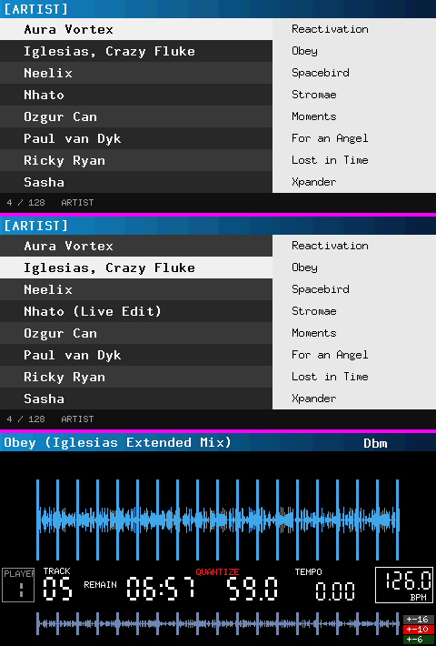

# embedded-gui on the CDJ-2000NXS BF531 GUI board: feasibility spike

Evaluation only (2026-10-09). BF531 at 400 MHz with no FPU, 480x234 X1RGB555,
owned Embassy kernel. Standalone crate (own workspace), not part of any
firmware link. It needs a cdj-2000nxs-mods checkout (read only) for the
target spec, the bench runtime, the linker script and `tools/build.py`.
Reproduce:

    (cd spikes/bfin && cargo +nightly run --release --bin host target/frames)
    python3 spikes/bfin/bfin/run.py          # CDJ_MODS=../cdj-2000nxs-mods by default

`run.py` follows the buoyant spike (cdj-2000nxs-mods `c6e26b8d`,
`analysis/buoyant-spike.md`):

- **Build:** `bfin-cdj-gui` target, `gui-firmware` profile, codegen_gcc,
  `-Zbuild-std=core,compiler_builtins`.
- **Link:** `bench_rt.S` + `bfin/main.c` under `gui_copy_test.ld` with
  `--gc-sections` and **no panic waiver**. Stack frame sizes come from
  `tools/build.py bfin_frame_sizes`.
- **Run:** `bfin-elf-run --environment virtual`, with `CYCLES` read at every
  step and every frame compared to the host render.
- **Soft-float, two passes.** Pass 1 reports which helpers are *linked*.
  Pass 2 relinks with `ld --wrap` on every one of those helpers, through
  counting stubs, and reports the helpers *called* per step.

Simulator cycles are not hardware time: there is no cache or SDRAM model.

## Fork tuning (branch fork/respin, 2026-10-09)

`python3 spikes/bfin/bfin/run.py [--opt 2|s] [--lines]` now builds the host
frames from the same tree, links the firmware's `_cdj_gui_fill16`
(cdj-2000nxs-mods `rust/gui/presentation/asm/copy.S`), and exits non-zero
unless all three gates pass: frames identical to host, 0 reachable panic
sites, 0 soft-float calls while rendering. Each commit was measured at O2
with its own bench. Frames 0-4 are byte-identical to the spike's.

| commit | browse full | player full | 1 row text | selection | digits | cycles/glyph | 6 images | .text KB | panic sites | stack B |
|---|---|---|---|---|---|---|---|---|---|---|
| bench at O2 (= spike code) | 5.11M | 5.09M | 416k | 772k | 73k | 16,322 | - | 76.4 | 31 | 61k ¹ |
| glyph masks to the target | 3.01M | 4.13M | 155k | 281k | 69k | 2,624 | - | 77.8 | 34 | |
| `_cdj_gui_fill16` row fills | 1.79M | 3.93M | 86k | 141k | 60k | 2,624 | - | 78.1 | 34 | |
| colour once per call, raw images | 1.00M | 2.61M | 87k | 143k | 58k | 2,681 | 102k | 80.6 | 37 | |
| spike waveform without division ² | 1.00M | 1.84M | 87k | 143k | 58k | 2,681 | 102k | 80.6 | 36 | |
| narrow fills, one bounds check | 1.00M | 1.40M | 87k | 143k | 54k | 2,681 | 102k | 80.6 | 36 | |
| borrow WidgetNode / styles | 0.99M | 1.39M | 85k | 141k | 52k | 2,681 | 101k | 77.2 | 36 | |
| `GuiContext::init_in_place` | 0.99M | 1.39M | 85k | 141k | 52k | 2,681 | 101k | 76.8 | 36 | 4,831 |
| panic-free render path | **0.99M** | **1.40M** | 85k | 142k | 52k | 2,696 | 101k | 74.0 | **0** | 4,623 |
| same, opt-level "s" | 1.34M | 2.24M | 139k | 217k | 105k | 3,802 | 153k | 74.6 | 5 | 4,291 |

¹ Measured high-water, saturated by two context temporaries.
² The spike's own widget, not the crate: the pixels are unchanged.

Second batch for respin-ui (2026-10-10), same gates, O2:

| commit | measure | before | after |
|---|---|---|---|
| ScrollView children follow `set_scroll_offset` | correctness (children were not offset) | | |
| O(1) node lookup, one-walk placement | 32-widget tree, damage on a 1x1 widget | 90.1k | 29.8k |
| | clock digits / one row text | 52.3k / 86.7k | 35.3k / 71.2k |
| `copy_rect` + `GuiContext::scroll_rect` | 480x90 waveform, 3 px scroll | 623k (full redraw) | 104k ³ |
| `smear_x`/`smear_y` (Rust) | 480x90, 8 taps | | 1.45M / 1.57M |
| `smear_line` hook + `bfin/smear.S` | 480x90, 8 taps | 1.45M / 1.57M | 504k / 813k |
| `TextOverflow::WholeGlyphs`, `WHOLE_GLYPHS` flag | feature | | |
| `RawImage` row stride | feature | | |
| `mask1_rows` hook + `bfin/mask1.S`, masks skip `blit` | 9x18 label glyph | 2.80k | 1.52k |
| | A1 16x16 glyph, one `draw_raw_image` each | ~5.9k ⁴ | 1.60k |
| | browse full / one row text / selection | 985k / 72.4k / 130k | 805k / 49.7k / 89.1k |
| | player full / 32-widget tree full | 1.38M / 596k | 1.32M / 468k |
| 256-entry palette used as the indexed8 table | 6 raw images (2 indexed8) | 108.6k | 106.2k |
| `WidgetFlags::OPAQUE` (browse rows flagged) | one row text / row slide | 50.2k / 536k | 43.4k / 526k |
| | 32-widget tree walk (flag scan) | 32.4k | 33.3k |

³ With `_cdj_gui_memmove` as `move_px`; the default memmove gives 462k.

⁴ 6.38k measured with `i % 20`/`i / 20` in the bench loop, less ~470 for the
two `___divsi3`/`___modsi3` calls: codegen_gcc emits them even for a constant
divisor, so per-item layout maths should use running counters or shifts. A
fully clipped `draw_raw_image` costs ~170 cycles (dyn call + clip), so a batch
glyph call would save under 10%.

NODES 32 -> 64 costs about 29 KB of context (31.8 -> 60.9 KB, about 910 B a
slot across the widget list and its per-node side tables). Render time
depends on the widgets actually present: about 930 cycles per widget per
damage pass for the tree walk.

Hand-tuned reference: 2.0-3.7M per full frame. Both screens are now below
it, at 2.5 ms (browse) and 3.6 ms (player) at 393 MHz.

What changed in the crate:

- `Compositor` hooks `ink`/`fill`/`mask`/`repeat_row`/`blit`. Their defaults
  are built on `fill_solid`, so existing targets are unchanged.
- `RawTarget` + `Direct`, and `GuiContext::render_with` / `render_dirty_with`.
- `Rgb555Surface`: X1RGB555 with a pluggable row fill. The 565 -> 555
  conversion happens once per call.
- `Font::glyph_mask` (A1, A4, A8).
- `RawImage` (ARGB1555, indexed8 + palette, tinted A4/A8/A1 masks), drawn
  only through the blit hook.
- `WidgetNode::render_at_styled`, which borrows the node and its styles.
- `GuiContext::init_in_place`.
- Panic-free indexing on the render path.

Left:

- Soft-float helpers are still *linked*: `lerp_style`, libm trig, and the
  slider/gauge/plotter arms. That needs the fixed-point fork (items 8-12
  below).
- Pluggable fonts: stock indexed fonts and CJK through `Font::glyph_mask`.
- A4/A8 blits are about 35 cycles/px on all-partial coverage.
- About 580 cycles of fixed cost per `fill_rect` call.
- Context side tables: 31.8 KB at NODES = 32. The largest items are the
  widgets, textarea undo/redo and class styles.

## Setup

- `embedded-gui` with `default-features = false, features = ["libm"]`. A math
  backend is mandatory: no_std builds `compile_error!` without `libm` or
  `micromath`. Nothing else is enabled (no `rich-widgets`, no
  `embedded-graphics`).
- **Rgb555 target:** an `Fb` `DrawTarget<Color = Rgb555>` with row-fill
  `fill_solid`. embedded-graphics `Rgb555` storage is X1RGB555 bit for bit.
  The whole embedded-gui render path is hard-wired to
  `DrawTarget<Color = Rgb565>` (179 bounds), so the surface is wrapped in the
  crate's own `ColorConvertedDrawTarget<_, Rgb565>`, which converts
  565 → 555 per call or pixel.
- **Screens** (layout from the stock references `stock-browse/artists.ppm`
  and `stock-loaded/obey-playing.ppm`):
  - **Browse:** gradient header, 8 rows with alternating fills and a selected
    row, a right pane with 8 entries, and a footer.
  - **Player:** title bar, waveform, PLAYER box, labels, seven-segment
    digits (track, time, frames, tempo, BPM), a BPM box, an overview
    waveform and the tempo-range tags.
  - **Widgets:** stock `Panel` + `Label` widgets, plus two `CustomWidget`s:
    the seven-segment digits (built from the crate's
    `SevenSegmentDisplay::digit_segments` + `encode_7seg`, which have no
    widget render of their own) and a waveform stand-in.
  - **Fonts:** embedded-graphics X11 bitmaps converted to embedded-gui
    `BitmapFont` (`gen_font.py`): 9x18 bold for the rows, 7x13 for the pane,
    6x10 for the small labels. Not the stock glyphs.
- **Context:** `GuiContext<'static, 32, 8, 8>` in a `static` (see Memory).

Frames, top to bottom: browse full frame; browse after the one-row text change
and the selection move (both through `render_dirty`); player full frame.
**All five dumped frames are byte-identical between Blackfin and the host.**

## Results

Two fork patches (on this branch, commit "render: integer identity check,
skip nodes outside damage") change the numbers a lot, so both columns are
shown. On the host, the patches leave every frame byte-identical to upstream.

| step (cycles, simulator) | upstream | + 2 patches | ms @393 MHz (patched) |
|---|---|---|---|
| browse: build (20 widgets) | 66k | 66k | 0.17 |
| **browse: full frame** | **8.03M** | **6.95M** | 17.7 |
| **browse: one row's text (`render_dirty`)** | **3.12M** | **0.60M** | 1.54 |
| browse: selection 0→1 (`render_dirty`, 2 rows) | 3.47M | 1.08M | 2.75 |
| player: build (21 widgets) | 98k | 98k | 0.25 |
| **player: full frame** | **7.96M** | **6.99M** | 17.8 |
| player: frames digits (`render_dirty`) | 2.29M | 0.13M | 0.34 |
| ref: raw `[u16]::fill` of the screen, our code | 1.15M | 1.15M | 2.92 |
| ref: one full-screen embedded-gui panel | 0.62M | 0.61M | 1.57 |
| ref: one 300x24 row label, 21 glyphs 9x18 | 0.69M | 0.55M | 1.41 |
| soft-float helper **calls**, whole run | 38,586 (`__eqsf2` only) | **0** | |

Against the baselines (per full frame):

| | cycles |
|---|---|
| buoyant (baseline to beat) | 17–27M ¹ |
| **embedded-gui, patched** | **6.95–6.99M** |
| embedded-gui, upstream | 7.96–8.03M |
| hand-tuned | 2.0–3.7M |

¹ The baseline is the figure given for this evaluation. The buoyant spike's
own smaller 6-row scene measured 4.8–5.6M.

### Where the time goes

**Text dominates.** One glyph costs about 25k cycles patched (30k upstream),
about 2× buoyant's per-glyph cost. `BitmapFont::draw_glyph_to` tests one bit
at a time and emits a span. Every span is a full `RenderCtx::fill_rect` call:

1. `fill_rounded_rect_alpha`
2. `visible_rect` against clip and dirty
3. a layer lookup
4. the transform check
5. `ColorConvertedDrawTarget` 565→555
6. `Fb::fill_solid`, which does its own `Rectangle` intersection

That is about 1k cycles for a 2–4 px span. The browse screen draws about 175
glyphs, roughly 4.4M of the 6.95M.

**Fills.** About 5.5 cycles/px for black (the `[u16]::fill` → memset path) and
about 10 cycles/px for other colors. This is our `Fb`, not embedded-gui:
embedded-gui's own overhead on a full-screen fill is negligible. A 32-bit
hardware-loop fill is our-side work.

**Upstream `render_dirty` was not culling.** `render_into` checked each node
against the viewport, not the damage. Every label was still styled and laid
out, and every glyph span was clipped one by one. A one-row change cost 39% of
a full frame; patched, it costs 8.7%.

**The only per-frame float was `Transform2D::is_identity()`.** It compares six
f32s and runs on every glyph and every span: 11.6k `__eqsf2` calls per full
frame, about 0.45M cycles. Comparing bit patterns fixes it, exactly. After that
patch the render path is **integer-clean in practice: 0 soft-float calls**
across both screens and all steps.

### Gates

- **Soft-float linked: FAIL.** 26 helpers are linked, including `double`
  (`__adddf3`, `__muldf3`, `__extendsfdf2`). There are 553 call sites in 17
  functions:
  - `lerp_style`: 224 sites. It is reachable from `render_into` when a
    visual-state transition runs.
  - Widget renders inlined into `render_at`: 112 sites (progress, slider,
    gauge…).
  - `RenderCtx::pixel`: 18 sites (alpha).
  - `libm` `sinf`/`cosf`/`rem_pio2*`: arcs and circles.
  - Plus `fill_circle` and `render_plotter`.

  None of these runs for these screens, but any animation, state transition
  or alpha would hit them. That is the fixed-point fork.
- **Panics: FAIL, but small.** `rust_begin_unwind` is reachable from 28 call
  sites in 14 functions (buoyant: 219 in 82). The causes:
  - Widget renders inlined into `render_at`: 13 sites (indexing).
  - `DirtyTracker::add` and `line_len_at`'s `str` slicing: 2 each.
  - The `transform_stack[len-1]` and `layer_stack[len-1]` indexing.
  - `BitmapFont::glyph_bytes`.
  - `mark_subtree_dirty`.
  - `str::chars().count()`.
  - One site is in the spike's own `Seg` widget.

  No `RefCell` and no `sort`. Everything is `get`/saturating work.
- **Stack frames: FAIL.** 13 functions exceed 256 B:
  - `Block::render` 1,328 B, `render_into` 1,324 B, `render_at` 1,204 B.
    `render_into` and `render_at` copy the 488 B `WidgetNode` by value per
    node.
  - `GuiContext::new` 1,064 B, `add_widget` 784 B, `Theme::dark` 732 B,
    `libm::rem_pio2_large` 700 B.
  - The spike's own `run` is 63,708 B. `MaybeUninit::write(Gui::new())` keeps
    two context temporaries on the stack under codegen_gcc. The measured
    high-water saturated at the 60 KiB paint, so a true render-only stack
    figure needs in-place init first. Estimate from the frames: about 5–6 KB.
- **`___bswapsi2`: PASS** (not referenced).

### Size

- `.text` 74.6 KB in total:

  | crate | .text |
  |---|---|
  | embedded_gui | 43.7 KB |
  | spike (screens, monomorphisations) | 8.7 KB |
  | compiler_builtins (soft-float, u64/u128) | 8.4 KB |
  | libm | 6.9 KB |
  | core | 4.0 KB |
  | embedded_graphics_core | 1.0 KB |
  | heapless | 0.2 KB |

  buoyant's total was 98.7 KB.
- rodata+data: 12.8 KB, mostly the three fonts (about 8 KB).
- u64/u128 helpers are linked (`__muldi3`, `__udivdi3`, `__multi3`).

### Memory

`GuiContext` keeps eight side tables sized by `NODES`: subscriptions,
dispatch policies, class styles, state transitions, press timings, key
policies, key bindings, and textarea undo/redo.

- **Blackfin size:** **31,788 B at `NODES = 32`**, about 990 B per node
  slot. On the host, `NODES = 48` is 58 KB.
- **Stack overflow:** the first run held two contexts on the 64 KiB
  simulator stack, overflowed into `.bss` and died on an unaligned access
  inside an unrelated `render_image`.
- **In firmware**, the context must be a `static` with in-place init. Its
  size has to come down: one screen at a time, with the tables
  feature-gated or given their own capacities.

### Redraw model (from source and the measurements)

Retained widget list with dirty rects:

- Each mutator adds the widget's absolute rect to a `DirtyTracker<DIRTY>`
  (merging on overflow).
- `render_dirty` renders the bounding rect in one pass when the rects
  cluster, or one pass per rect.
- `render_dirty_occlusion` adds a quadtree damage tree with opaque-cover
  skipping, which buoyant lacks. It was not measured here.
- Node lookup is a linear `find`. `absolute_rect`, `effective_visible` and
  `inherited_clip` each walk parents, so a frame is O(N²) in nodes. That is
  negligible at about 25 nodes; at 100+ nodes it needs an index.
- Pointer and touch input already exist (`PointerState`, gestures, drag,
  long-press).
- **Resolution:** the viewport is a parameter and `Fb` is sized at run time.
  The spike's two screens use fixed 480x234 coordinates; `LinearLayout` and
  `GridLayout` exist for an 800x480 variant.

## Verdict: adopt with fork

- **For:** It compiles for Blackfin under codegen_gcc unpatched, and renders
  byte-identically to the host.
  - It beats buoyant by 2.5–3.9× on full frames (patched).
  - Its damage model works once nodes are culled: 0.13–0.6M cycles for
    typical updates, so a 60 Hz clock or row update fits easily.
  - The render path is integer-clean after a one-function fix.
  - The panic and frame problems are local (`get`/saturating, no by-value
    copies), not architectural as they were in buoyant.
- **Against direct adoption:**
  - Full frames are 2–3× slower than hand-tuned code, because of the glyph
    span path.
  - The fixed `Rgb565` color type costs a per-call conversion and is wrong
    for our image formats.
  - Floats are everywhere outside the static render path (motion, style
    lerp, arcs).
  - The context is large and has no in-place init.

  All of these are fork-sized, not rewrites.

## Fork change list

Done on this branch (measured above):

| # | change | effort |
|---|---|---|
| 0a | `Transform2D::is_identity` compares bit patterns (no `__eqsf2` per span) | done |
| 0b | `render_into` skips nodes outside the pass's damage rect | done |

Needed to adopt (render path, memory, gates):

| # | change | effort |
|---|---|---|
| 1 | **Color-generic render path:** a `color-rgb555` feature that makes `ActiveColor = Rgb555`. Replace the hard-coded `Rgb565` (1,839 mentions in 63 files, 179 `DrawTarget` bounds) with `ActiveColor`, and rebuild the color constant tables per format. `ActiveColor` already exists but the render path ignores it. | M, 3–4 d (mechanical + test fixups) |
| 2 | **Glyph mask fast path:** a row-span or mask blit per glyph that clips and resolves the layer/transform once per glyph, not per span. Optionally `DrawTarget`-side `fill_span`. Expected: about 25k → 2–3k cycles/glyph, and full frames about 7M → 2.5–3.5M (estimate, not measured). | M, 2–3 d |
| 3 | **Pluggable glyph source** for stock indexed fonts and CJK (`nxs-ui` `Assets::glyph`): a span/mask method on the `Font` trait, which is already object-safe through `FontId::Dynamic`. | S, 1 d |
| 4 | **Image formats:** premultiplied RGB555 + optional 5-bit alpha plane, ARGB1555 and indexed8 (only raw Rgb565 `ImageRef` and 1-bit `MonoBitmap` exist today), with row-run blits. | M, 3 d |
| 5 | **Context memory:** `GuiContext::init_in_place(&mut MaybeUninit<Self>)`. Feature-gate the textarea undo/redo, key bindings and press timings tables, or give them their own const capacities. Stop copying `WidgetNode` by value in `render_into`/`render_at`. | M, 2–3 d |
| 6 | **Panic-free:** fix the 28 sites (`get`, saturating, stack-depth guards), then make the bench's panic count a CI gate. | S, 1–2 d |
| 7 | **Frames ≤ 256 B** on the render path: split `render_at`'s widget match arms with `#[inline(never)]`, and pass styles by reference in `Block::render`. | S–M, 1–2 d |

Fixed-point fork (all motion and style math off floats). The static render
path no longer needs it, but it's needed as soon as anything animates:

| # | change | effort |
|---|---|---|
| 8 | **`fixed-point` feature:** `Scalar` = `fixed::types::I16F16` (the `fixed` crate already built under codegen_gcc in the buoyant spike), with `Scalar = f32` otherwise. Motion and style APIs (`Tween`, `Animation`, `Keyframe`, `SpringAnimator`, `InertiaAnimator`, `lerp_style`) take `Scalar`. `lerp_style` and `state_transition_progress` move to `u8` t, which is integer in both builds. | M, 3–4 d (256 f32 uses in `motion/`) |
| 9 | **Easing as build-time 256-entry tables:** one Q1.15 (`i16`, so Back/Elastic overshoot fits) `static` per curve, generated by `build.rs` from the current f32 formulas, with linear interpolation between entries. One static per curve lets `--gc-sections` drop unused ones (about 0.5 KB per curve). | S, 1 d |
| 10 | **Fixed-step springs and timelines:** semi-implicit Euler at a fixed 1 ms substep, replacing the closed-form `exp`/`sin`/`cos` per tick. Inertia friction becomes a per-ms factor table instead of `powf`. Timers are already `u32` ms. | M, 2 d |
| 11 | **Transforms and Bézier gated off** under `fixed-point`: `Transform2D`/`translate`/`rotate`/`skew`, image rotate/scale, quad/cubic Bézier, `VectorPath`, PDC, `CatmullRomSpline`, arc gauges/circles (`libm` trig) and 3D interop behind a `float-geometry` feature. That removes `libm` from the link. | M, 2 d |
| 12 | **Float-vs-fixed parity test:** every `Easing`, `Tween`, `Spring` and `Timeline` is run in both builds over the same `dt_ms` sequences and mapped to pixel positions over spans up to 800 px; `assert!(Δ ≤ 1 px)`. A bench gate checks that a `fixed-point` link has **0 soft-float helpers linked**. | S, 1 d |

Total: about 4–5 weeks for one engineer.
- Items 1–7, adoption: about 2.5–3 weeks.
- Items 8–12, fixed point: about 1.5–2 weeks.
